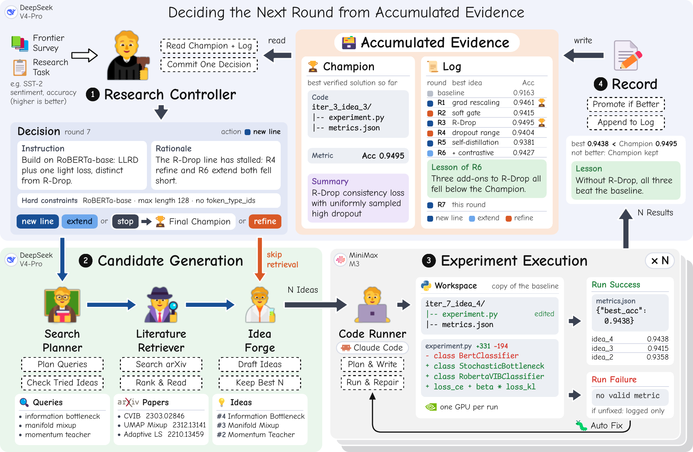
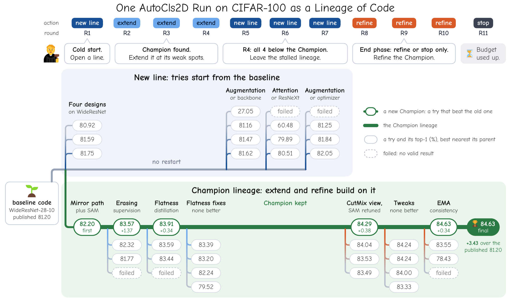

<div align="center">

# BRED

### The Between-Round Decision in Autonomous Research:<br>An LLM Controller That Reads the Whole Trajectory

[](https://www.python.org/)
[](https://github.com/anthropics/claude-agent-sdk-python)
[](LICENSE)

**English** | [简体中文](README_zh.md)

</div>

After every round of experiments, an autonomous research system has to decide what to do next:
refine the best solution so far or start a new direction, which solution to build from, and what
goal to set. **BRED** (Between-Round Evidence-based Decision) makes this decision with **one LLM call
per round**, reading two persistent objects: the **Champion**, the best verified solution so far, and
a **log** of every past round.

> [!NOTE]
> This repository is a **simplified reference implementation** of the BRED loop. The controller is
> a fixed schedule, and literature search, idea generation and the coding agent are reduced to
> single calls. It runs end to end on all four tasks but **does not reproduce the paper's numbers**.
> The full implementation will be released after the paper is published.

<p align="center">
  
</p>
<p align="center"><sub>
One round of BRED in the paper, shown on round 7 of the SST-2 run. (1) The controller reads the
Champion and the log and commits one decision. (2) A new line or an extension retrieves papers and
drafts ideas; a refinement skips retrieval. (3) Each idea is implemented and run in its own copy of
the starting workspace. (4) The round's best candidate replaces the Champion only if it beats it,
and the round is appended to the log.
</sub></p>

## The method

- **Decisions from evidence.** Each round the controller picks one of four actions: start a new
  line from the baseline, extend the Champion with a new mechanism, refine the Champion, or stop.
  It also sets a goal-level instruction for the round.
- **The best result never regresses.** A candidate replaces the Champion only on a strict, verified
  improvement, so a failed round costs nothing already won.
- **Real experiments.** A coding agent (Claude Code through the Claude Agent SDK) implements each
  candidate in its own workspace and runs it under the task's frozen evaluation protocol.
- **One controller, any task.** A task is a baseline `experiment.py`, a metric and a short
  description.

## Results

Reported in the paper: the best verified metric of the final Champion, following the benchmark's
reporting convention.

| Task (dataset) | Metric | Baseline | Dolphin | InternAgent<br>(published) | InternAgent<br>(re-run†) | **BRED** |
|---|---|---:|---:|---:|---:|---:|
| AutoTSF (ETTh1) | MAE ↓ | 0.4382 | 0.4627 | 0.4331 | 0.4245 | **0.4172** |
| AutoClsSST (SST-2) | Acc. ↑ | 91.63 | 92.50 | 93.50 | 92.78 | **95.07** |
| AutoCls2D (CIFAR-100) | Acc. ↑ | 81.20 | 82.00 | 83.30 | 83.44 | **84.63** |
| AutoDepDAIC (DAIC-WOZ) | Macro-F1 ↑ | 56.10 | – | – | – | **61.64**‡ |

<sub>Dolphin and published InternAgent numbers are taken from the InternAgent paper. The AutoCls2D
baseline is the published WideResNet-28-10 result; the other baselines are the verified floors of the
paper's runs. † InternAgent's released code run with the same models as BRED. ‡ Mean over five seeds
held out from selection (± 1.66), under the leakage-free protocol of HAREN-CTC, whose own result under
that protocol is 57.6.</sub>

**How much of the history does the controller need?** Same loop and budget; only what the
decision step reads changes.

| Decision step reads | AutoTSF (MAE ↓) | AutoCls2D (Acc. ↑) |
|---|---:|---:|
| No history: every round restarts from the baseline | 0.4299 | 83.71 |
| The last round only | 0.4244 | 84.01 |
| The Champion and the full log (BRED) | **0.4172** | **84.63** |

## How a run unfolds

<p align="center">
  
</p>
<p align="center"><sub>
The paper's CIFAR-100 run as a lineage of code. R1–R3 build one lineage up to 83.91%. When R4 fails
to extend it, the controller opens three new lines from the baseline (R5–R7); none beats the
Champion, so it is kept. Two refinements in the closing rounds lift it to 84.63%.
</sub></p>

## This release

The loop structure, the four tasks and the Champion/log bookkeeping are the same as in the paper.
The components inside each step are simplified:

| Step | In the paper | In this release |
|---|---|---|
| **Decide** | One LLM call reads the Champion and the full log and chooses the action and the instruction | A fixed schedule: a new line until a Champion exists, then extend and refine in turn |
| **Generate** | Search planning, paper retrieval and reading, idea generation and selection | One arXiv query (abstracts only) and one LLM call that drafts N ideas |
| **Run** | A coding agent implements, runs and repairs each candidate | One coding-agent session implements the idea; the experiment runs once, without repair |
| **Record** | The Champion changes only on a strict improvement; the round is appended to the log | Same |

## Quick start

**Requirements**

- Linux with NVIDIA GPUs. The paper's runs used RTX 2080 Ti (11 GB) GPUs.
- An OpenAI-compatible chat model (the paper used `deepseek-v4-pro`).
- An Anthropic-compatible endpoint for the coding agent (the paper used MiniMax-M3; the Anthropic
  API or DeepSeek's Anthropic endpoint also work). The Claude Code CLI is bundled with the SDK.

**1. Install**

```bash
conda create -n bred python=3.11 -y && conda activate bred
pip install -r requirements.txt
```

**2. Configure**

```bash
cp .env.example .env   # fill in DEEPSEEK_API_KEY and ANTHROPIC_API_KEY
```

Then check these entries in [`config.yaml`](config.yaml):

| Key | What to set |
|---|---|
| `llm` | Model, `base_url` and key of the chat model |
| `code_runner.python` | The interpreter that runs `experiment.py`, e.g. `~/anaconda3/envs/bred/bin/python` |
| `code_runner.gpus` | GPU ids; each running candidate takes one |
| `code_runner.claude_sdk_env` | Base URL and model of the coding agent's endpoint |

**3. Run**

AutoTSF needs no extra data (ETTh1 is bundled), so it is the fastest task to start with.

```bash
# Decide, search and draft ideas, without running experiments (no GPU, no coding agent)
python scripts/run_pipeline.py --task AutoTSF --rounds 2 --skip-experiments

# The full loop: 10 rounds, 3 candidates per round
python scripts/run_pipeline.py --task AutoTSF --rounds 10 --workers 3
```

The other tasks need datasets and model weights first; see [docs/DATA.md](docs/DATA.md).

## What a run produces

```text
storage/runs/{Task}/{run_name}/          # run_name defaults to a timestamp
├── run.log
├── memory.json                          # every decision and candidate, and the Champion
├── rounds/round_{t}.json                # the round's decision, query, papers and ideas
└── workspaces/r{t}_c{k}/                # each candidate's code, metrics.json and run.log
```

## Tasks

| Task | Dataset | Primary metric | Baseline |
|---|---|---|---|
| AutoTSF | ETTh1, multivariate, look-back 336, horizons {96, 192, 336, 720} | MAE ↓ | DLinear |
| AutoClsSST | SST-2 | dev accuracy ↑ | BERT-base fine-tuning |
| AutoCls2D | CIFAR-100 | top-1 accuracy ↑ | WideResNet-28-10 |
| AutoDepDAIC | DAIC-WOZ, subject-level 5-fold CV × 5 seeds | macro-F1 ↑ | frozen wav2vec 2.0 + linear probe |

To add your own, see [docs/ADD_A_TASK.md](docs/ADD_A_TASK.md).

## Repository layout

```text
├── scripts/run_pipeline.py      # entry point
├── src/
│   ├── loop.py                  # Decide -> Generate -> Run -> Record
│   ├── memory.py                # the Champion and the log
│   ├── agents/
│   │   ├── controller.py        # Decide (a fixed schedule in this release)
│   │   ├── planner.py           # search query
│   │   ├── retriever.py         # arXiv API
│   │   ├── idea_forge.py        # idea drafting
│   │   └── code_runner.py       # coding agent and experiment run
│   ├── llm.py                   # OpenAI-compatible chat client
│   └── config.py
├── resources/baseline/{Task}/   # baseline code, task description, baseline metric
├── tasks/{Task}/config.yaml     # time limit and metric
├── docs/                        # task data, adding a task
└── tests/                       # offline tests: python -m pytest tests -q
```

## FAQ

<details>
<summary><b>Why are my results below the paper's?</b></summary>

This release replaces the controller with a fixed schedule and simplifies generation and execution
(see [This release](#this-release)). It shows how the loop is put together, not how well the full
system performs.
</details>

<details>
<summary><b>Every candidate fails.</b></summary>

Check `workspaces/r{t}_c{k}/run.log` and the `error` field in `memory.json`. The usual causes are a
coding-agent endpoint that is out of quota or rate limited (the agent returns without changing the
code), a wrong `code_runner.python`, or missing task data.
</details>

<details>
<summary><b>Can I use other models?</b></summary>

Yes. The `llm` section takes any OpenAI-compatible endpoint, and the coding agent takes any
Anthropic-compatible endpoint through `code_runner.claude_sdk_env`.
</details>

## Acknowledgements

AutoTSF, AutoClsSST and AutoCls2D follow the task protocols of
[InternAgent](https://github.com/InternScience/InternAgent). AutoDepDAIC uses
[DAIC-WOZ](https://dcapswoz.ict.usc.edu/) under the leakage-free protocol of HAREN-CTC. We thank arXiv
for use of its open access interoperability.

## License

The code is released under the [MIT License](LICENSE). The baseline code of AutoTSF, AutoClsSST and
AutoCls2D is adapted from InternAgent and remains under the Apache License 2.0; see
[THIRD_PARTY_NOTICES.md](THIRD_PARTY_NOTICES.md).
