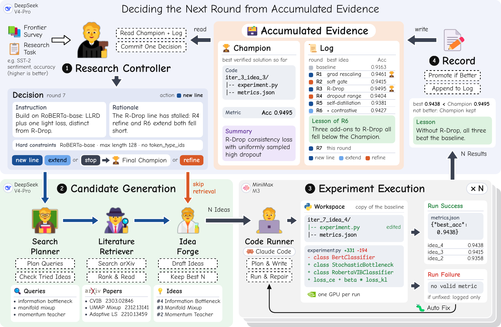
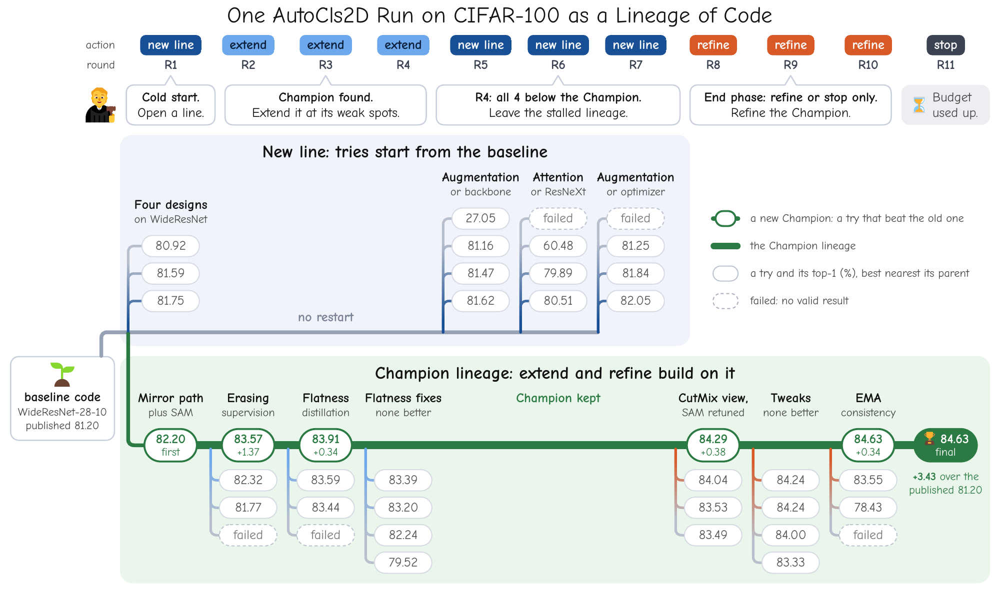

<div align="center">

# BRED

### The Between-Round Decision in Autonomous Research:<br>An LLM Controller That Reads the Whole Trajectory

[](https://www.python.org/)
[](https://github.com/anthropics/claude-agent-sdk-python)
[](LICENSE)

[English](README.md) | **简体中文**

</div>

自主科研系统每做完一轮实验，都要决定下一步：继续精修当前最好的方案还是换个方向，从哪个方案出发，
这一轮定什么目标。**BRED**（Between-Round Evidence-based Decision）**每轮只用一次 LLM 调用**做这个
决策，读取两个持久对象：**Champion**（迄今最好的已验证方案）和记录每一轮的**日志**。

> [!NOTE]
> 本仓库是 BRED 循环的**简化参考实现**：控制器是固定日程，文献检索、idea 生成和代码 agent 都简化为
> 单次调用。四个任务都能端到端跑通，但**不能复现论文中的数字**。完整实现将在论文正式发表后发布。

<p align="center">
  
</p>
<p align="center"><sub>
论文中 BRED 的一轮，以 SST-2 运行的第 7 轮为例。(1) 控制器读取 Champion 和日志，做出一个决策。
(2) 新开一条线或扩展 Champion 时检索论文、起草 idea；精修则跳过检索。(3) 每个 idea 在起点 workspace
的独立副本中实现并运行。(4) 本轮最好的候选只有超过 Champion 才会取代它，本轮随后追加进日志。
</sub></p>

## 方法

- **依据证据做决策。** 每轮控制器在四个动作中选一个：从 baseline 新开一条线、在 Champion 上加入新机制
  做扩展、精修 Champion，或停止；同时给出本轮目标层面的指令。
- **最好结果不会倒退。** 候选只有在严格、已验证地超过 Champion 时才会取代它，失败的一轮不会损失已有成果。
- **真实实验。** 代码 agent（通过 Claude Agent SDK 调用 Claude Code）在独立 workspace 中实现每个候选，
  并按任务冻结的评测协议运行。
- **一个控制器，任意任务。** 一个任务就是一个 baseline `experiment.py`、一个指标和一段简短描述。

## 结果

论文报告的结果：最终 Champion 的最佳已验证指标，按基准的报告惯例给出。

| 任务（数据集） | 指标 | Baseline | Dolphin | InternAgent<br>（论文报告） | InternAgent<br>（复跑†） | **BRED** |
|---|---|---:|---:|---:|---:|---:|
| AutoTSF (ETTh1) | MAE ↓ | 0.4382 | 0.4627 | 0.4331 | 0.4245 | **0.4172** |
| AutoClsSST (SST-2) | Acc. ↑ | 91.63 | 92.50 | 93.50 | 92.78 | **95.07** |
| AutoCls2D (CIFAR-100) | Acc. ↑ | 81.20 | 82.00 | 83.30 | 83.44 | **84.63** |
| AutoDepDAIC (DAIC-WOZ) | Macro-F1 ↑ | 56.10 | – | – | – | **61.64**‡ |

<sub>Dolphin 和 InternAgent 论文报告的数字取自 InternAgent 论文。AutoCls2D 的 baseline 是已发表的
WideResNet-28-10 结果，其余 baseline 是论文运行中验证过的地板值。† 用与 BRED 相同的模型运行
InternAgent 的开源代码。‡ 在不参与选择的五个种子上取平均（± 1.66），采用 HAREN-CTC 的无泄漏协议；
HAREN-CTC 在该协议下的结果为 57.6。</sub>

**控制器需要多少历史？** 循环和预算不变，只改变决策步骤能读到的内容。

| 决策步骤读取 | AutoTSF (MAE ↓) | AutoCls2D (Acc. ↑) |
|---|---:|---:|
| 不读历史：每轮都从 baseline 重新开始 | 0.4299 | 83.71 |
| 只读上一轮 | 0.4244 | 84.01 |
| Champion 和完整日志（BRED） | **0.4172** | **84.63** |

## 一次运行如何展开

<p align="center">
  
</p>
<p align="center"><sub>
论文中 CIFAR-100 那次运行的代码谱系。R1–R3 沿一条谱系做到 83.91%。R4 扩展失败后，控制器从 baseline
新开三条线（R5–R7），都没超过 Champion，于是保留原 Champion。收尾阶段的两次精修把它提到 84.63%。
</sub></p>

## 本仓库与论文的区别

循环结构、四个任务以及 Champion 和日志的记录方式与论文一致，各步骤内部的组件做了简化：

| 步骤 | 论文 | 本仓库 |
|---|---|---|
| **Decide** | 一次 LLM 调用读取 Champion 和完整日志，选择动作并给出指令 | 固定日程：还没有 Champion 时从 baseline 新开一条线，之后扩展和精修交替进行 |
| **Generate** | 检索规划、论文检索与阅读、idea 生成与筛选 | 一次 arXiv 查询（只用摘要），一次 LLM 调用起草 N 个 idea |
| **Run** | 代码 agent 实现、运行并修复每个候选 | 一次代码 agent 会话实现 idea，实验只运行一次，不做修复 |
| **Record** | 只有严格提升才更新 Champion，本轮追加进日志 | 相同 |

## 快速开始

**环境要求**

- 带 NVIDIA GPU 的 Linux。论文实验使用 RTX 2080 Ti（11 GB）。
- 一个 OpenAI 兼容的对话模型（论文使用 `deepseek-v4-pro`）。
- 代码 agent 用的 Anthropic 兼容端点（论文使用 MiniMax-M3；Anthropic 官方 API 或 DeepSeek 的
  Anthropic 端点也可以）。Claude Code CLI 随 SDK 一起安装。

**1. 安装**

```bash
conda create -n bred python=3.11 -y && conda activate bred
pip install -r requirements.txt
```

**2. 配置**

```bash
cp .env.example .env   # 填写 DEEPSEEK_API_KEY 和 ANTHROPIC_API_KEY
```

然后检查 [`config.yaml`](config.yaml) 中的这几项：

| 配置项 | 说明 |
|---|---|
| `llm` | 对话模型的名称、`base_url` 和 key |
| `code_runner.python` | 运行 `experiment.py` 的解释器，例如 `~/anaconda3/envs/bred/bin/python` |
| `code_runner.gpus` | GPU 编号；每个正在运行的候选占一张 |
| `code_runner.claude_sdk_env` | 代码 agent 端点的 base URL 和模型 |

**3. 运行**

AutoTSF 不需要额外数据（已附带 ETTh1），最适合先跑。

```bash
# 只做决策、检索和起草 idea，不跑实验（不需要 GPU 和代码 agent）
python scripts/run_pipeline.py --task AutoTSF --rounds 2 --skip-experiments

# 完整循环：10 轮，每轮 3 个候选
python scripts/run_pipeline.py --task AutoTSF --rounds 10 --workers 3
```

其他任务需要先准备数据集和模型权重，见 [docs/DATA.md](docs/DATA.md)。

## 运行产物

```text
storage/runs/{Task}/{run_name}/          # run_name 默认为时间戳
├── run.log
├── memory.json                          # 每个决策、每个候选，以及 Champion
├── rounds/round_{t}.json                # 本轮的决策、检索词、论文和 idea
└── workspaces/r{t}_c{k}/                # 每个候选的代码、metrics.json 和 run.log
```

## 任务

| 任务 | 数据集 | 主指标 | Baseline |
|---|---|---|---|
| AutoTSF | ETTh1，多变量，回看 336，预测长度 {96, 192, 336, 720} | MAE ↓ | DLinear |
| AutoClsSST | SST-2 | dev 准确率 ↑ | BERT-base 微调 |
| AutoCls2D | CIFAR-100 | top-1 准确率 ↑ | WideResNet-28-10 |
| AutoDepDAIC | DAIC-WOZ，受试者级 5 折交叉验证 × 5 个种子 | macro-F1 ↑ | 冻结的 wav2vec 2.0 + 线性探针 |

添加自己的任务见 [docs/ADD_A_TASK.md](docs/ADD_A_TASK.md)。

## 目录结构

```text
├── scripts/run_pipeline.py      # 入口
├── src/
│   ├── loop.py                  # Decide -> Generate -> Run -> Record
│   ├── memory.py                # Champion 和日志
│   ├── agents/
│   │   ├── controller.py        # Decide（本仓库中为固定日程）
│   │   ├── planner.py           # 检索词
│   │   ├── retriever.py         # arXiv API
│   │   ├── idea_forge.py        # 起草 idea
│   │   └── code_runner.py       # 代码 agent 与实验运行
│   ├── llm.py                   # OpenAI 兼容的对话客户端
│   └── config.py
├── resources/baseline/{Task}/   # baseline 代码、任务描述、baseline 指标
├── tasks/{Task}/config.yaml     # 时限和指标
├── docs/                        # 任务数据、添加任务
└── tests/                       # 离线测试：python -m pytest tests -q
```

## 常见问题

<details>
<summary><b>为什么我的结果低于论文？</b></summary>

本仓库把控制器换成了固定日程，并简化了生成和执行步骤（见[本仓库与论文的区别](#本仓库与论文的区别)）。
它展示的是循环如何搭建，而不是完整系统的效果。
</details>

<details>
<summary><b>所有候选都失败了。</b></summary>

查看 `workspaces/r{t}_c{k}/run.log` 和 `memory.json` 中的 `error` 字段。常见原因：代码 agent 端点额度
用完或被限流（agent 没改代码就返回）、`code_runner.python` 配置错误，或任务数据缺失。
</details>

<details>
<summary><b>可以换用其他模型吗？</b></summary>

可以。`llm` 接受任何 OpenAI 兼容端点；代码 agent 通过 `code_runner.claude_sdk_env` 接受任何
Anthropic 兼容端点。
</details>

## 致谢

AutoTSF、AutoClsSST 和 AutoCls2D 沿用 [InternAgent](https://github.com/InternScience/InternAgent)
的任务协议。AutoDepDAIC 使用 [DAIC-WOZ](https://dcapswoz.ict.usc.edu/)，采用 HAREN-CTC 的无泄漏协议。
感谢 arXiv 提供开放访问接口。

## 许可证

代码以 [MIT 许可证](LICENSE)发布。AutoTSF、AutoClsSST 和 AutoCls2D 的 baseline 代码改编自
InternAgent，仍适用 Apache License 2.0，见 [THIRD_PARTY_NOTICES.md](THIRD_PARTY_NOTICES.md)。
